# Blueprint Memory Lab

面向 UE5 初学者的 Blueprint 中英学习工具，结合艾宾浩斯复习、主动回忆、拆词记忆、场景串联、Epic 官方教程查询和语音朗读。

## 在线使用

- 网页版：<https://hyx3251591466.github.io/ue5-blueprint-memory-lab/>
- 下载中心：<https://hyx3251591466.github.io/ue5-blueprint-memory-lab/download.html>

## 界面预览

### 首页与专注背诵

| 今日学习 | 专注背诵设置 |
| --- | --- |
| 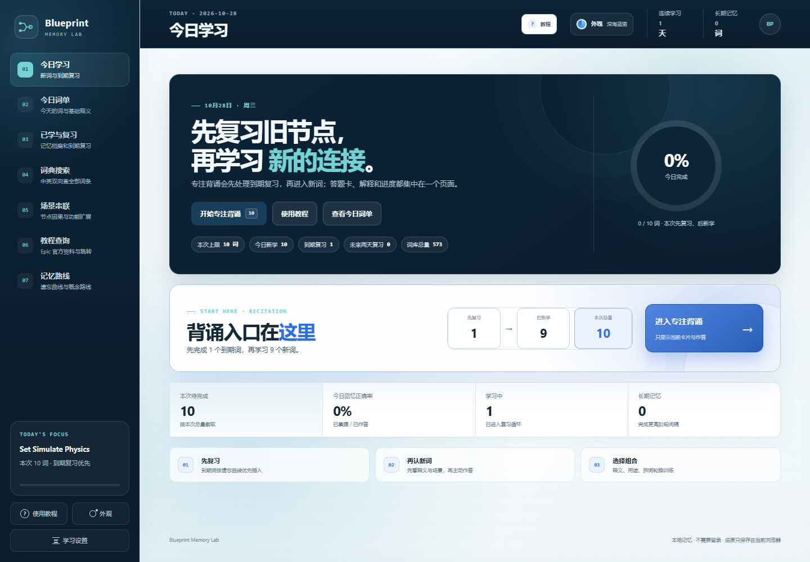 | 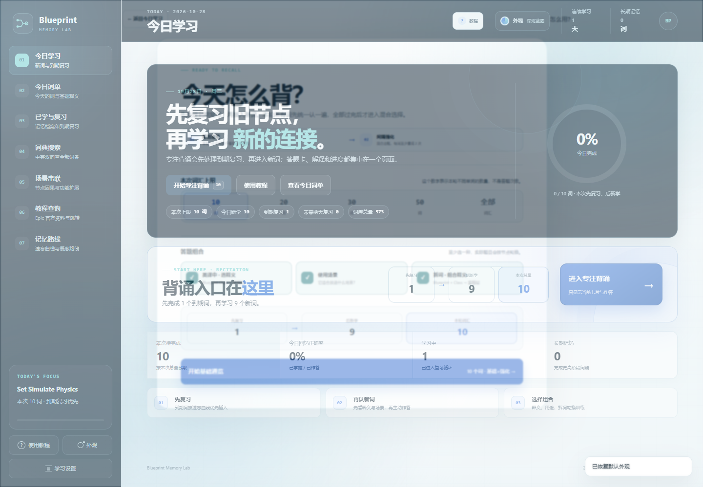 |

| 基础通览 | 混合选择题 |
| --- | --- |
| 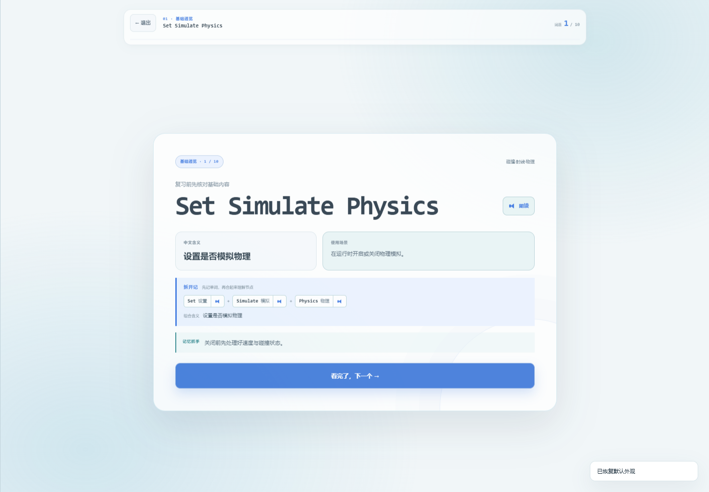 | 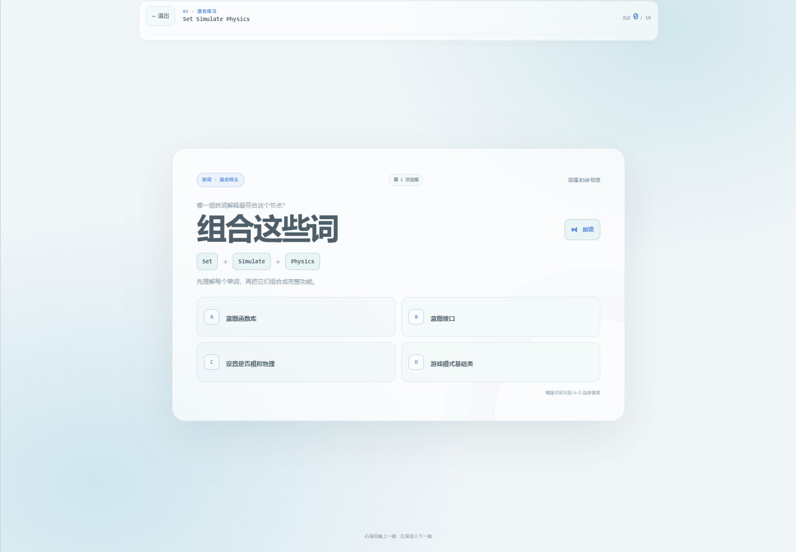 |

| 滑动回看历史卡 | 本地拆词翻译侧卡 |
| --- | --- |
| 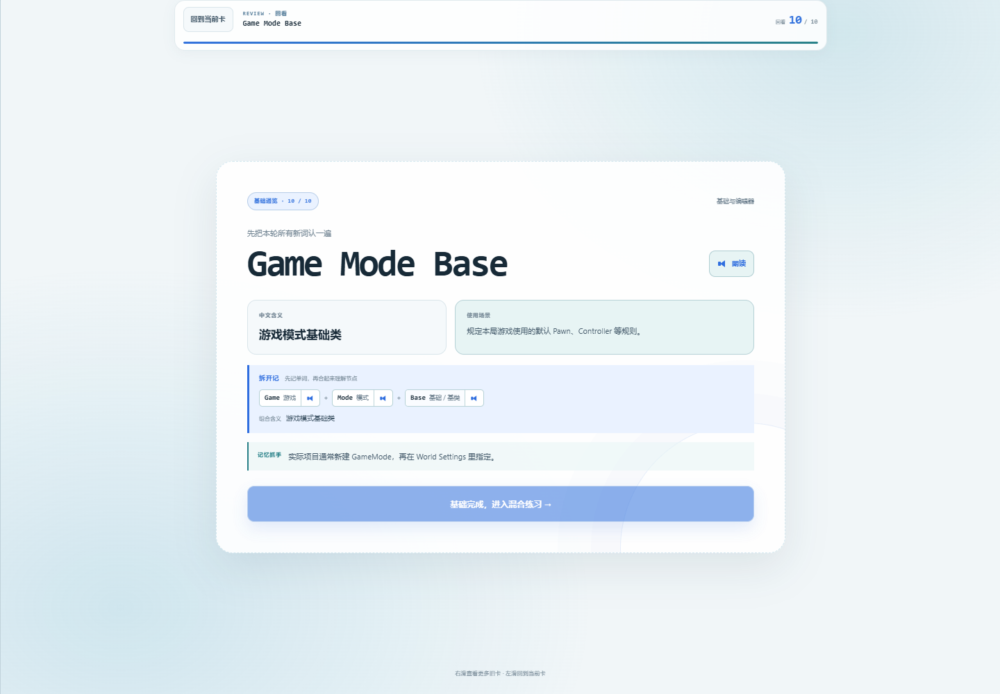 | 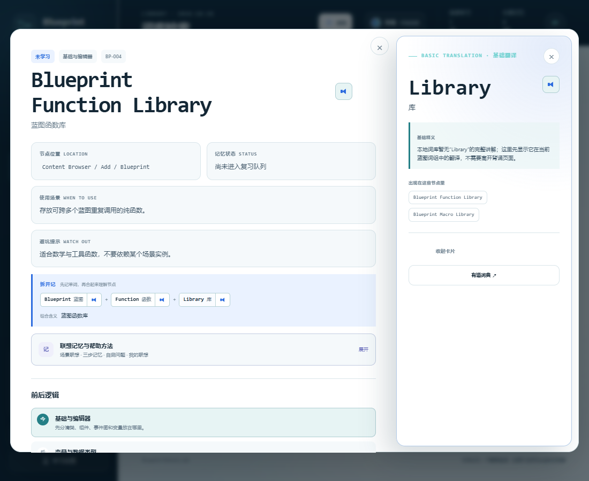 |

| 独立学习设置 |
| --- |
| 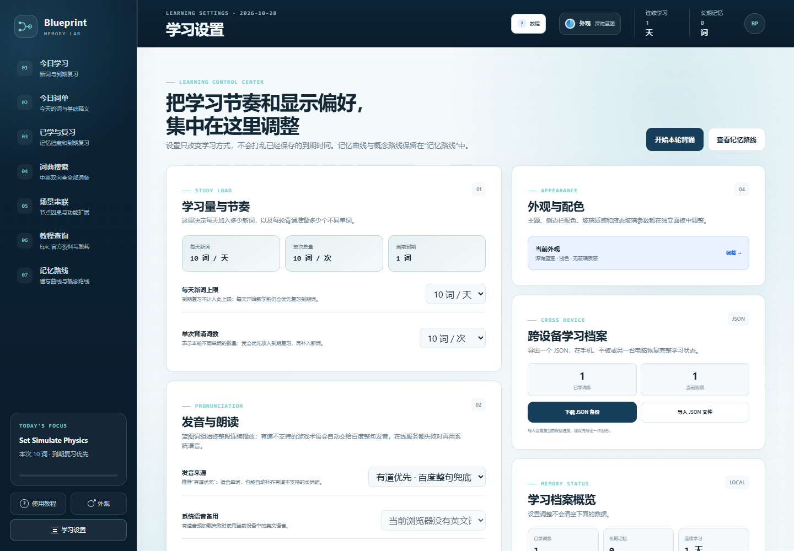 |

| 可拖动查词卡 |
| --- |
| 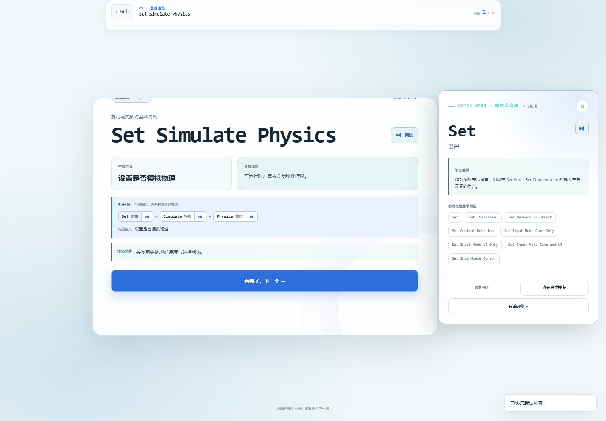 |

| 中途续学 | 自定义主题 |
| --- | --- |
| 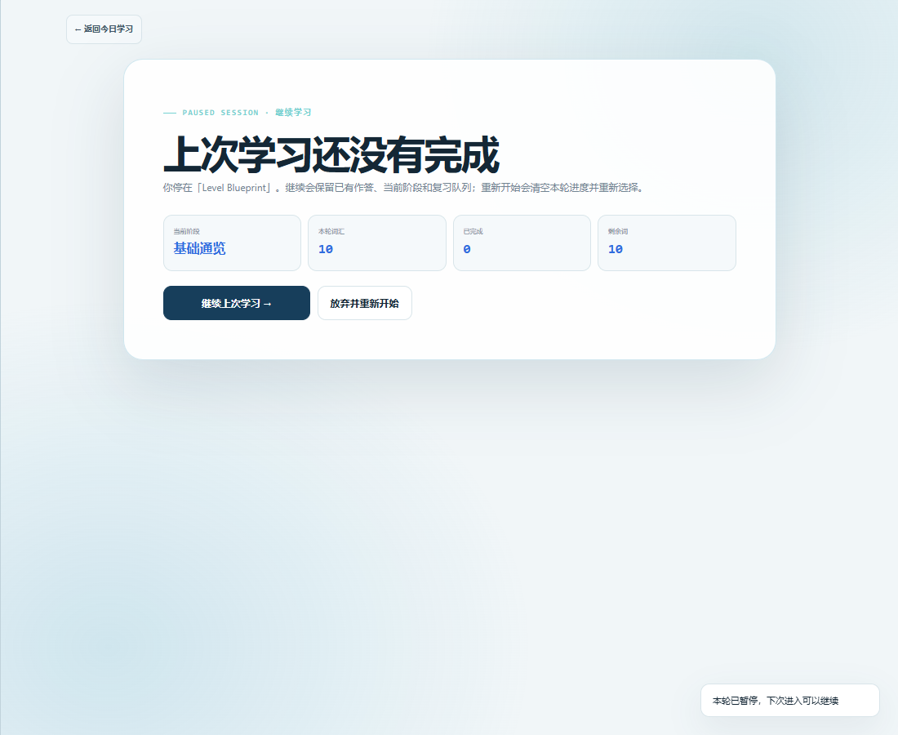 | 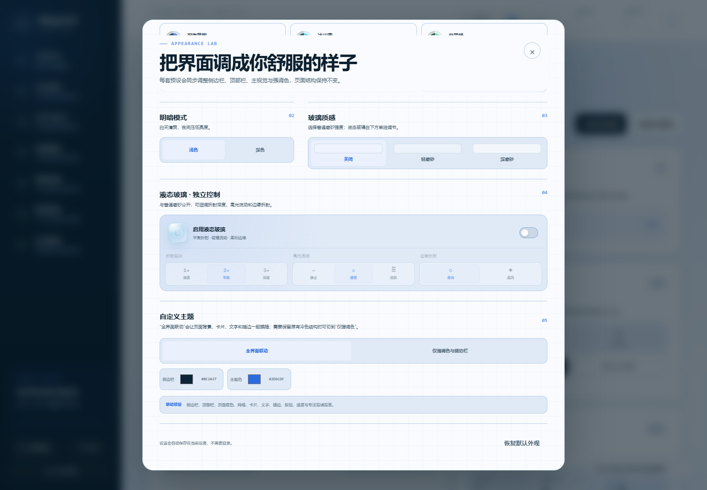 |

### 手机端

| 今日学习 | 侧边栏导航 | 词典筛选 |
| --- | --- | --- |
| 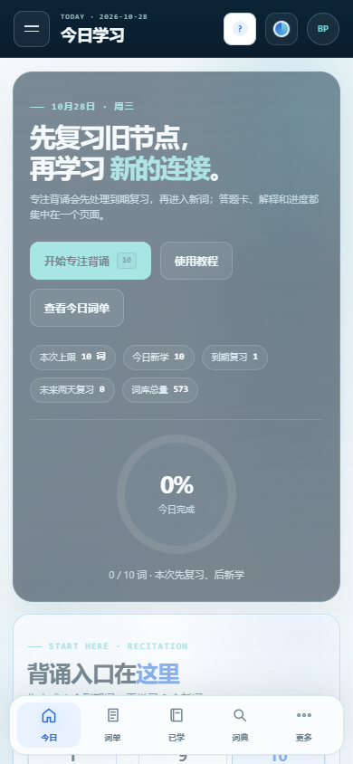 | 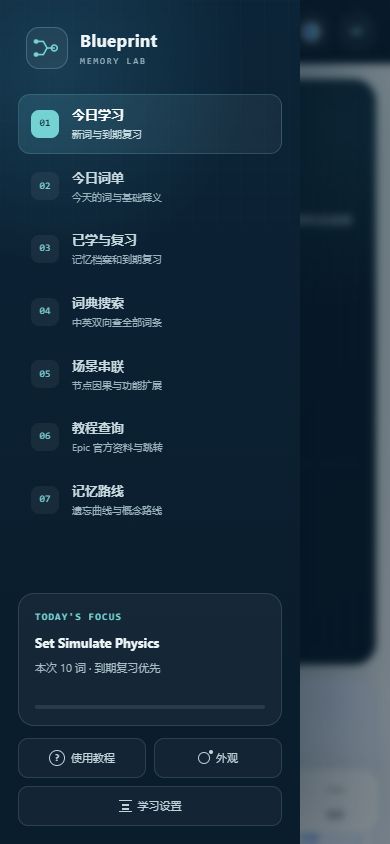 | 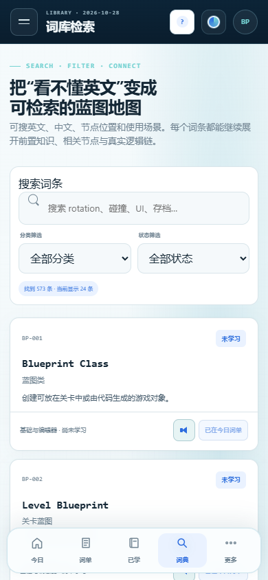 |

## 下载

- **Android APK**：[Blueprint-Memory-Lab-v1.2.9-universal.apk](https://github.com/hyx3251591466/ue5-blueprint-memory-lab/releases/download/v1.2.9/Blueprint-Memory-Lab-v1.2.9-universal.apk)
- **网页离线 ZIP**：[Blueprint-Memory-Lab-Web-v1.2.9.zip](https://github.com/hyx3251591466/ue5-blueprint-memory-lab/releases/download/v1.2.9/Blueprint-Memory-Lab-Web-v1.2.9.zip)
- **安装说明**：[DOWNLOAD-AND-INSTALL.txt](https://github.com/hyx3251591466/ue5-blueprint-memory-lab/releases/download/v1.2.9/DOWNLOAD-AND-INSTALL.txt)

Android 版：

- 版本 `1.2.9`，包名 `com.blueprintmemorylab.app`
- 支持 Android 6.0 及以上
- 可直接覆盖升级旧版并保留学习进度
- 使用 v1、v2、v3 签名方案
- 当前使用项目证书签名，适合直接侧载，不适合提交 Google Play

## 功能

- 573 个 UE5 Blueprint 常用词条，支持中英文搜索
- 独立专注背诵页：先完成全部词条基础通览，再集中进入混合选择题
- 可组合英译中、使用场景与拆词组义题；完整题目选项只使用本轮词条
- 会话内间隔强化：每个词至少重现两次，答错会更快再次出现，最终结果只写入一次跨天复习计划
- 专注卡支持全向跟手拖动与惯性滑出：右滑回看旧卡，左滑进入下一词
- 右滑回看尚未作答的历史卡时可直接继续答题，不必中断本轮重来
- 右滑回看旧卡时仍可朗读，切卡或离开页面会停止上一段录音，避免串音
- 中途退出专注学习会保留当前词、答题队列与反馈状态；再次进入先询问继续上次或重新开始
- 每日任务先复习后新学，单次背诵总量与每天新词量均可选择
- 独立的“学习设置”页集中管理学习量、发音、外观、跨设备档案和清理进度
- 加入今日词单后停留在当前页面；满额时可选择本次超额加入或顶替最后一位
- 今日词单、已学词库与艾宾浩斯到期复习
- 拆词查义以侧卡展开：词条详情旁并排显示，或从专注页旋转斜向滑出
- 浮动词义卡默认出现在右侧中部，可拖动标题栏并记住位置，窗口变化时自动收回可见范围
- 切换主卡时查词卡默认自动收起，可在学习设置中改为保持打开，并可一键恢复默认位置
- 词库未收录的拆词子项先显示本地基础翻译，再提供可选的有道跳转
- 分层的词条详情导航，关闭子词义后恢复原词条、滚动位置与展开状态
- 首次使用五步教程、手机端引导和全局主题色彩过渡
- 专注背诵网格背景固定铺满完整视口，桌面和手机均不再局限于中间工作区
- 学习进度 JSON 导入导出，可跨设备恢复阶段、到期时间、联想笔记和外观设置
- 场景串联左侧索引在桌面滚动时固定，手机端保持单层自然滚动
- 手机端词典筛选改为分区网格，侧栏打开后置顶并支持点击遮罩或按 Esc 自动收起
- 移动端搜索框固定为 13px 字号，避免浏览器自动放大造成突兀
- Service Worker 改为网络优先并用缓存离线兜底，版本升级不再优先显示旧页面
- 444 个多词组节点拆词记忆
- 智能整句朗读：有道优先，百度整句自动兜底，系统语音最终回退
- 在线版通过 Service Worker 同源代理请求整句音频，避免第三方音频接口因网页 Referer 返回空页面
- 全部 573 个词条完成在线整句音频覆盖检查，长词组不再逐词拼接
- 每个词条的联想画面、记忆方法和自测问题
- 可编辑并本地保存的个人联想笔记
- 8 条 Blueprint 场景逻辑链
- Epic 官方中文文档与学习资源
- 五套完整主题预设，可分别自定义侧边栏和强调色
- 自定义主题支持“全界面联动”：页面背景、网格、卡片、文字、描边、按钮和专注背景同步变化
- 可切换为“仅强调色与侧边栏”，保留原有冷色主体结构
- 浅色、深色与三档磨砂玻璃
- 独立液态玻璃：三档折射层次、三档高光流动与两档边缘折射

## 本地使用

直接打开 `index.html`。学习记录保存在浏览器 `localStorage` 中。

## 资料来源

- [Epic Developer Community 中文文档](https://dev.epicgames.com/documentation/zh-cn/unreal-engine/unreal-engine-5-6-documentation)
- [Epic 官方 Unreal Engine 学习目录](https://dev.epicgames.com/community/learning)
- [网易有道词典](https://dict.youdao.com/)

Blueprint Memory Lab 是非官方学习工具，与 Epic Games 和网易有道无隶属关系。相关名称和资料归各自权利人所有。

## 许可证

本项目代码与原创学习工具内容采用 MIT License，详见 [LICENSE](./LICENSE)。Epic Games、Unreal Engine、网易有道等名称及链接资料仍归各自权利人所有。
