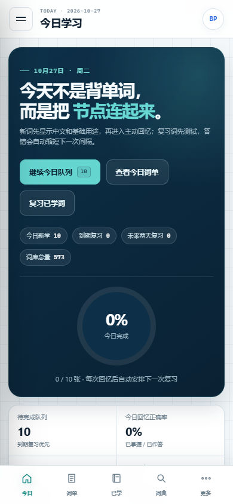

# Blueprint Memory Lab

UE5 Blueprint 中英学习工具，支持艾宾浩斯复习、拆词/联想记忆、场景串联、官方教程检索和语音朗读。

## 直接下载

无需克隆仓库，直接下载发行版文件：

- **安卓 APK**：[下载 Blueprint-Memory-Lab-v1.0.1.apk](https://github.com/hyx3251591466/ue5-blueprint-memory-lab/releases/download/v1.0.1/Blueprint-Memory-Lab-v1.0.1.apk)
- **网页离线 ZIP**：[下载 Blueprint-Memory-Lab-Web-v1.0.0.zip](https://github.com/hyx3251591466/ue5-blueprint-memory-lab/releases/download/v1.0.1/Blueprint-Memory-Lab-Web-v1.0.0.zip)
- **安装说明**：[下载 DOWNLOAD-AND-INSTALL.txt](https://github.com/hyx3251591466/ue5-blueprint-memory-lab/releases/download/v1.0.1/DOWNLOAD-AND-INSTALL.txt)
- **在线使用**：[打开 GitHub Pages 网页版](https://hyx3251591466.github.io/ue5-blueprint-memory-lab/)
- **全部发行版**：[GitHub Releases](https://github.com/hyx3251591466/ue5-blueprint-memory-lab/releases)

## Android 安装

1. 下载 `Blueprint-Memory-Lab-v1.0.1.apk`。
2. 点击 APK 安装；如果系统提示，允许浏览器或文件管理器“安装未知应用”。
3. 支持 Android 8.0 及以上。
4. 词库、复习和联想记忆功能已打包在 APK 内，可离线使用。
5. 有道词典发音需要网络；不可用时使用 Android 系统英文 TTS。
6. 当前 APK 使用项目调试证书签名，适合直接侧载，不适合直接提交 Google Play。

## 网页离线 ZIP

1. 下载并完整解压 `Blueprint-Memory-Lab-Web-v1.0.0.zip`。
2. 保持所有文件在同一个文件夹。
3. 双击 `index.html`，推荐使用最新版 Edge 或 Chrome。

## 主要功能

- 573 个 UE5 Blueprint 常用词条，支持中英文搜索
- 444 个词组节点拆分记忆，可单独查词或跳转有道词典
- 艾宾浩斯式九阶段复习：5 分钟、30 分钟、12 小时、1/2/4/7/15/30 天
- 今日词单、已学词库、到期复习和个人学习档案
- 每个词条包含联想画面、帮助方法和自测问题
- 有道词典发音与系统语音自动降级
- 8 条 Blueprint 场景逻辑链
- 16 条 Epic 官方中文学习资料，支持多层筛选
- 学习进度本地保存，可导出和导入 JSON

## 仓库说明

本仓库保存网页版源码。Android APK、网页离线 ZIP 和校验文件位于 [Releases](https://github.com/hyx3251591466/ue5-blueprint-memory-lab/releases)。

## 资料来源

- [Epic Developer Community 中文文档](https://dev.epicgames.com/documentation/zh-cn/unreal-engine/unreal-engine-5-6-documentation)
- [Epic 官方 Unreal Engine 学习目录](https://dev.epicgames.com/community/unreal-engine/learning)
- [网易有道词典](https://dict.youdao.com/)

Blueprint Memory Lab 是非官方学习工具，与 Epic Games 和网易有道无隶属关系。
